## Resumo

A solução PLN tem quatro camadas, construídas uma por sprint e usadas em sequência:

| Sprint | Camada | Entrega principal |
|--------|--------|-------------------|
| 1 | Base linguística | glossário PT/EN de 170 termos, corpus estruturado de 84 campos, pipeline de normalização |
| 2 | Consulta semântica | busca híbrida (embeddings + lexical + filtro numérico) sobre o cadastro de 8 ativos |
| 3 | Geração e classificação | resumos de alerta em 3 níveis de severidade, classificação de eventos, relatório rastreável |
| 3/4 | Assistente RAG | troubleshooting sobre 5 manuais WEG, com estado operacional do ativo no prompt |

O assistente RAG foi entregue junto com a Sprint 3, em agosto. Por isso, nesta sprint final não houve módulo novo. O trabalho foi corrigir as falhas que a avaliação anterior expôs, fazer todos os notebooks rodarem e documentar o resultado com os números reais.

Na avaliação final, o assistente passou a recusar **4 de 4** perguntas fora de escopo; na Sprint 3 eram 3. Além disso, a confiança mostrada ao operador deixou de ser "ALTA" em todas as respostas.

O custo dessas mudanças está medido e declarado neste documento:
- a faithfulness caiu de 0,743 para 0,678;
- uma pergunta legítima passou a ser recusada.

---

## 1. O que avançou da Sprint 3 até a apresentação final

### 1.1 Ponto de partida

A avaliação do próprio grupo já tinha registrado cinco problemas no assistente:

1. **Alucinação fora de escopo.** Perguntado sobre a configuração de um inversor *de outro fabricante* (F02), o modelo respondeu com instruções e citou documentos da WEG como fonte.
2. **Confiança sem informação.** O modelo declarou `Confiança: ALTA` nas 20 perguntas do gabarito, inclusive nas duas em que a recuperação trouxe o trecho errado. Um sinal que nunca muda não serve ao operador.
3. **Cópia do exemplo do prompt.** A resposta de T16 (vibração após o acoplamento) saiu praticamente igual ao exemplo de formato do prompt de sistema, que tratava de desalinhamento e correia.
4. **Número trocado.** Em T01, o limite de 155 °C da classe F virou 150 °C, com a marca de fonte ao lado.
5. **Notebook da Sprint 1 sem saídas.** Ele dependia de montar o Google Drive e nunca tinha sido executado fora do Colab.

### 1.2 O que foi feito

| # | Ajuste | Onde | Problema que resolve |
|---|--------|------|----------------------|
| 1 | **Recusa determinística por limiar.** Se a relevância do melhor trecho recuperado fica abaixo de 0,60, o LLM nem é chamado e o assistente responde com uma recusa padrão. | `pln/assistente.py` | alucinação fora de escopo (F02) |
| 2 | **Confiança calculada pelo sistema.** A linha de confiança exibida é calculada pela recuperação (ALTA ≥ 0,85; MÉDIA ≥ 0,60). A confiança que o modelo declara fica só no registro, para comparação. | `pln/assistente.py` | confiança sempre ALTA |
| 3 | **Relevância sem bônus de contexto.** O score usado no limiar e na confiança é *denso + 0,35 × lexical*, sem os bônus de família e de ativo do re-ranking. | `pln/assistente.py` | o score composto inflava a confiança das perguntas com contexto |
| 4 | **Exemplo do prompt trocado** por um caso fictício de outro aparelho, sem números | `PROMPT_SISTEMA` | cópia do exemplo (T16) |
| 5 | **Verificador de números sem fonte literal.** Todo número da resposta que não aparece nos trechos, no estado do ativo ou na pergunta é listado no registro. | `numeros_sem_suporte()` | número trocado (T01) passa a ser detectado |
| 6 | **Consulta composta no diálogo.** No 2º turno em diante, a busca usa a pergunta anterior junto com a atual. | `Assistente.responder` | regressão causada pelo ajuste 1 (seção 1.4) |
| 7 | Notebooks das quatro sprints executados, com saídas visíveis | 4 notebooks | reprodutibilidade |
| 8 | Comparativo antes/depois com a mesma régua | `scripts/comparar_sprint3.py` | evitar comparação enganosa (seção 1.5) |

### 1.3 Três tentativas para o exemplo do prompt

Trocar o exemplo do prompt parecia o ajuste mais simples. Na prática, foi o que mais mexeu nos resultados. As três variantes foram avaliadas no gabarito completo, e todas estão preservadas em `relatorios/`:

| Variante | Faithfulness | Fora de escopo recusadas | O que aconteceu |
|----------|--------------|--------------------------|-----------------|
| Sprint 3: desalinhamento e correia (dentro do corpus) | 0,743 | 3 de 4 | T16 copiou o exemplo |
| Iteração 1: compressor, "filtro a cada 2 000 horas" | 0,760 | 4 de 4 | **o exemplo vazou para T18**, e o verificador de números pegou o "2 000" |
| Iteração 2: só marcadores (`<causa tirada de um trecho> [FONTE 1]`) | 0,638 | 2 de 4 | o modelo perdeu o formato e várias respostas saíram com o corpo vazio |
| **Final:** geladeira, sem números, declarado fictício | 0,678 | 4 de 4 | sem vazamento, sem corpo vazio |

O critério de escolha foi fixado antes de comparar os números, nesta ordem:
1. nenhum vazamento do exemplo e nenhuma resposta vazia;
2. recusa fora de escopo;
3. faithfulness.

A iteração 1 teve a maior faithfulness, mas uma resposta que recomenda "trocar o filtro a cada 2 000 horas" num motor elétrico é exatamente o erro que o assistente não pode cometer.

**Lição registrada:** só a redação do exemplo moveu a faithfulness de 0,64 a 0,76. Com 20 perguntas e um modelo de 3B, essa sensibilidade é do mesmo tamanho dos efeitos que queremos medir.

### 1.4 Uma regressão encontrada na demonstração e corrigida

Depois do limiar de recusa, a demonstração em diálogo mostrou um problema: **o 2º turno dos três cenários foi recusado.** Perguntas como "A corrente também subiu 10%. Isso muda o diagnóstico?" não têm o assunto explícito. Buscadas sozinhas, recuperam trechos sem relação e ficam abaixo de 0,60 (relevância de 0,39 a 0,56).

A correção foi buscar com a pergunta anterior junto com a atual. Com ela, os seis turnos foram respondidos, com relevância de 0,62 a 0,73. A versão com o defeito está em `relatorios/sprint4_iteracao3_cenarios_sem_consulta_composta.json`.

O caso mostra por que o gabarito sozinho não basta: ele roda sem memória e nunca teria exposto esse defeito.

### 1.5 Antes × depois

Para comparar, as respostas da Sprint 3 foram reavaliadas com o mesmo critério da Sprint 4: métricas sobre o *corpo* da resposta, sem a linha de confiança.

Na Sprint 3, a linha de confiança entrava no juiz NLI e contava como frase sem suporte. Por isso o valor publicado então (0,690) difere do 0,743 reavaliado. A diferença vem da régua, não do assistente.

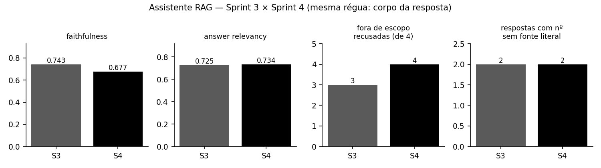

| Métrica (20 perguntas + 4 fora de escopo) | Sprint 3 | Sprint 4 |
|-------------------------------------------|----------|----------|
| Faithfulness (juiz NLI, por frase) | 0,743 | 0,678 |
| Answer relevancy | 0,725 | 0,734 |
| Perguntas fora de escopo recusadas | 3 de 4 | **4 de 4** |
| Confiança exibida | 20 × ALTA | 7 ALTA · 12 MÉDIA · 1 BAIXA |
| Respostas com citação de fonte | 100% | 95% (a 5% restante é a recusa de T13) |
| Respostas com número sem fonte literal | 2 (não detectadas na época) | 2 (detectadas e registradas) |
| Tempo médio por resposta (CPU) | 20,3 s | 19,9 s |

Leitura honesta:
- **Ganho real:** a fronteira de escopo (F02 deixou de ser respondida) e uma confiança que varia conforme a recuperação.
- **Perda real:** faithfulness 0,065 menor e T13 recusada sem necessidade. Com a sensibilidade medida na seção 1.3, não dá para atribuir essa diferença de faithfulness a nenhum ajuste específico.

### 1.6 Notebooks executados

| Notebook | Antes | Agora | Métricas reproduzidas |
|----------|-------|-------|-----------------------|
| `sprint1_pln_corpus.ipynb` | 0 de 24 células com saída (dependia do Drive) | 24 de 24, sem erro | 7 documentos, 69.671 tokens, vocabulário de 15.658 |
| `sprint2_pln_consulta.ipynb` | executado | 15 de 15 | P@1 0,944 · R@3 1,000 (idênticos) |
| `sprint3_pln_alertas.ipynb` | executado | 29 de 29 | artefatos idênticos byte a byte aos de agosto |
| `sprint4_pln_rag.ipynb` | executado | 18 de 18, com a nova seção 8 (antes × depois) | ver seção 1.5 |

A única mudança de código no notebook da Sprint 1 foi permitir execução local: o Drive só é montado quando o notebook roda no Colab.

### 1.7 Mantido, evoluído, substituído

| Entregável da Sprint 3 | Situação | Justificativa |
|------------------------|----------|---------------|
| Resumos de alerta por template (ROUGE-1 0,550) | **mantido** | rastreáveis, sem número inventado (checklist 100%); nada nesta sprint justificou trocar |
| Classificador híbrido zero-shot + regras (macro-F1 0,838) | **mantido** | o ganho é parcialmente ajuste ao corpus (seção 3.2); sem dados novos, mexer seria sobreajustar mais |
| Relatório operacional (38 de 38 linhas rastreáveis) | **mantido** | — |
| Índice RAG e retriever com re-ranking (MRR 0,758) | **mantido** | — |
| Confiança declarada pelo LLM | **substituído** | pela confiança calculada (seção 1.2, ajuste 2) |
| Prompt de sistema | **evoluído** | exemplo novo (seção 1.3) |
| Assistente | **evoluído** | limiar de recusa, verificador de números, consulta composta |
| Documento técnico das Sprints 3 e 4 | **corrigido** | ver abaixo |

**Correções no que foi publicado em agosto:**
- O documento da Sprint 3 dizia que a pergunta não recusada era F04 (vida útil do rolamento). O arquivo `fora_de_escopo.csv` da própria entrega mostra que F04 foi recusada e que a falha foi **F02** (inversor de terceiro).
- O notebook dizia "~3,5 min por resposta em CPU". O valor medido com o modelo quantizado em uso é ~20 s.

---

## 2. Diferenciais e resultados da solução

### 2.1 Métricas reais

Todos os números abaixo saem de arquivos versionados em `relatorios/` e foram reproduzidos nesta sprint.

| Módulo | Métrica | Valor | Conjunto |
|--------|---------|-------|----------|
| Busca semântica (S2) | P@1 / R@3 | 0,944 / 1,000 | 18 consultas, 8 ativos |
| Resumos de alerta (S3) | ROUGE-1 / ROUGE-2 / ROUGE-L | 0,550 / 0,296 / 0,405 | 24 alertas × referência manual |
| Resumos de alerta (S3) | checklist automático (10 critérios) | 100% | 24 alertas |
| Classificação de eventos (S3) | macro-F1: zero-shot / TF-IDF + LogReg / híbrido | 0,603 / 0,763 / **0,838** | conjunto de teste, 168 eventos no total |
| Relatório operacional (S3) | linhas com âncora até o sensor | 38 de 38 | relatório semanal |
| Retriever (S4) | context recall@4 / MRR / precision@4 | 0,90 / 0,758 / 0,338 | 20 perguntas com gabarito de seção |
| Retriever (S4) | MRR sem → com re-ranking lexical | 0,563 → 0,758 | idem |
| Assistente (S4) | faithfulness / answer relevancy | 0,678 / 0,734 | idem |
| Assistente (S4) | recusa fora de escopo | 4 de 4 | 4 perguntas |
| Assistente (S4) | recusa indevida no gabarito | 1 de 20 (T13) | 20 perguntas |

### 2.2 Diferenciais técnicos

**Domínio industrial específico.** O vocabulário controlado vem dos documentos do fabricante:
- 170 termos PT/EN em 7 categorias, com tipos e causas de falha alinhados à tabela oficial WEG de danos em enrolamentos;
- as decisões de pré-processamento foram medidas, não presumidas. O stemming RSLP foi rejeitado porque juntava termos que o domínio distingue (*isolamento* × *isolante*).

**Português técnico.** Embeddings multilíngues e classificador NLI multilíngue. As respostas são em português, com números no formato brasileiro (vírgula decimal) e unidades preservadas.

**Rastreabilidade até o sensor.** Cada afirmação tem origem verificável:
- os resumos de alerta e o relatório trazem âncoras até a leitura de sensor (`[FONTE: leituras_sensores.csv | ...]`);
- as respostas do assistente marcam o trecho do manual (`[FONTE n]`) e o registro guarda documento, seção e página de cada trecho;
- o verificador de números lista o que não tem fonte literal.

**Contexto operacional real no prompt.** O estado do ativo calculado na Sprint 3 entra no prompt do assistente e orienta o retriever: situação (EM RISCO, EM OBSERVAÇÃO...) e os resumos dos alertas abertos. O operador pergunta "este motor"; o assistente sabe qual é e o que está acontecendo com ele.

**Decisões críticas fora do LLM.** Na versão final, quem decide se responde e com que confiança é o código, a partir de um sinal medido (a relevância da recuperação). O modelo de 3B redige; não arbitra.

**Tudo offline, em CPU.** Embeddings, juiz NLI, classificador zero-shot e LLM quantizado (Qwen2.5-3B, GGUF Q4_K_M) rodam localmente, sem chamada a API externa e sem GPU.

### 2.3 Demonstração documentada: falha mecânica no MT-008

Os três cenários (elétrico, mecânico e manutenção planejada) aparecem nos prints P09 a P11 do Anexo, na seção 7 do notebook `sprint4_pln_rag.ipynb` e, transcritos sem edição, em `evidencias/demo_cenarios_falha.md`. O cenário mecânico é reproduzido abaixo.

**Estado injetado no prompt:** EM RISCO, com alertas críticos abertos:
- temperatura do mancal +17,8 °C sobre o baseline por 5,1 dias;
- vibração global de 4,4 mm/s (+112,8% sobre o baseline).

> **Operador:** A vibração deste motor mais que dobrou em cinco dias. O que verificar primeiro?

> **Assistente:** A primeira coisa a verificar é o alinhamento do motor [FONTE 1]. Em seguida, verifique o balanceamento do motor [FONTE 2]. Além disso, verifique o rolamento e a lubrificação do mancal [FONTE 1]. Se necessário, faça a inspeção e a substituição do rolamento [FONTE 1]. Confiança: MÉDIA — calculada pela recuperação (relevância do melhor trecho: 0,68).

> **Operador:** O alinhamento foi conferido e está correto. O que mais pode causar isso?

> **Assistente:** O desbalanceamento do motor também pode causar vibração [FONTE 2]. A temperatura do mancal foi a principal causa apontada [FONTE 1]. Outro fator a ser verificado é a lubrificação do rolamento [FONTE 2]. A vibração também pode ser causada por desalinhamento [FONTE 1]. Confiança: MÉDIA — calculada pela recuperação (relevância do melhor trecho: 0,70).

**O que a demonstração mostra:**
- **Funciona:** o assistente usa o estado do ativo (cita o mancal, que vem do alerta e não da pergunta) e mantém o fio do diálogo.
- **Falha 1:** no 2º turno, repete "desalinhamento" mesmo depois de o operador dizer que o alinhamento estava correto.
- **Falha 2:** cita como fonte trechos que não tratam de vibração. As marcas [FONTE 1] e [FONTE 2] apontam para as seções de isolação e de vida útil do motor (`evidencias/demo_cenarios_falha.md`).

As duas falhas estão catalogadas na seção 3.3.

As perguntas fora de escopo aparecem no print P08 e estão transcritas, lado a lado entre a Sprint 3 e a 4, em `evidencias/fora_de_escopo_antes_depois.md`. Os logs completos de execução estão em `evidencias/log_*.txt`; o print P13 mostra um trecho.

---

## 3. O que ficou pendente, por que e possíveis melhorias

### 3.1 Itens não concluídos do escopo

| Item | Situação | Motivo |
|------|----------|--------|
| Integração dos resumos e do assistente ao painel do gêmeo digital | **não feita** | O painel Streamlit gera seus próprios resumos (Gemini 2.5 Flash, com template de reserva) e não consome o módulo `pln/`. As duas camadas foram desenvolvidas em paralelo e não houve prazo para unificar o contrato. É a primeira proposta da seção 4. |
| Avaliação com juiz LLM (RAGAS) | **não feita** | Exige um LLM juiz maior que o gerador; em CPU, sem chave de API, o custo de 20 perguntas × várias métricas era incompatível com o prazo. Usamos juiz NLI offline, mais rígido (seção 3.2). |
| Validação do limiar em conjunto independente | **não feita** | O limiar de 0,60 foi escolhido olhando as mesmas 24 perguntas em que é avaliado. Faltou tempo para escrever um segundo gabarito. |
| Cobertura de procedimentos de manutenção detalhados | **parcial** | O corpus indexado é majoritariamente de especificação: intervalos de relubrificação por carcaça e torques de aperto não estão no material em português. |
| Demonstração da solução em funcionamento | **concluída como sequência de prints** | O enunciado aceita vídeo ou sequência de prints; optamos pelos prints, que mostram as saídas reais dos notebooks executados. Estão no Anexo, ao fim deste documento. |

Os itens citados no enunciado como exemplos de pendência foram **concluídos**: o re-ranking contextual do retriever, a avaliação com 20 perguntas de diagnóstico e a cobertura dos três cenários de falha.

### 3.2 Limitações conhecidas

| Limitação | Evidência | Efeito |
|-----------|-----------|--------|
| **A confiança calculada mede a recuperação, não a resposta** | faithfulness média por nível: ALTA 0,56 · MÉDIA 0,72 | O nível diz se a documentação cobre o assunto, não se o modelo a usou bem. Não pode ser lido como probabilidade de acerto. |
| **Nenhum limiar separa os grupos sem erro** | T13 (0,545) fica abaixo de F02 (0,571); ver Figura 2 | 0,60 troca uma recusa indevida por uma alucinação evitada. |
| **Sensibilidade ao prompt** | faithfulness de 0,64 a 0,76 só trocando o exemplo | Diferenças menores que ~0,1 com 20 perguntas não são conclusivas. |
| **Não determinismo do LLM** | Com temperatura 0 e semente fixa, o mesmo 1º turno saiu com redação diferente em duas execuções (llama.cpp em CPU com várias threads) | Reexecutar a avaliação não reproduz os mesmos números exatos; os artefatos versionados são a referência. |
| **Juiz NLI rígido com paráfrase** | respostas corretas com vocabulário diferente do trecho são penalizadas | A faithfulness absoluta tende a ser subestimada; a comparação entre versões usa a mesma régua. |
| **Citação nem sempre aponta o trecho certo** | MT-008, 2º turno: as marcas [FONTE 1] e [FONTE 2] apontam para as seções de isolação e de vida útil do motor, que não tratam de vibração | A marca de fonte existe em 95% das respostas, mas não é verificada. |
| **Corpus sintético** | 8 ativos, 24 alertas, 168 eventos, séries simuladas | As métricas validam o pipeline, não substituem dados de planta. |
| **Regras do classificador ajustadas ao corpus** | parte do ganho de 0,603 para 0,838 vem de regras escritas sobre os erros deste conjunto | Um corpus novo pode exigir revisar os marcadores. |
| **Stopwords acentuadas na Sprint 1** | "nao" aparece entre os termos mais frequentes: a lista de stopwords tem "não" e é aplicada depois da remoção de acentos | As estatísticas de frequência da Sprint 1 ficam levemente infladas. Não afeta as sprints seguintes, que normalizam de outro jeito. |
| **Infraestrutura (Colab)** | o LLM de 3B quantizado ocupa ~2 GB (arquivo GGUF) e leva ~20 s por resposta em CPU; no Colab gratuito a sessão cai por inatividade | As inferências caras vêm pré-computadas em `relatorios/`, e as células de recomputação estão sinalizadas. |

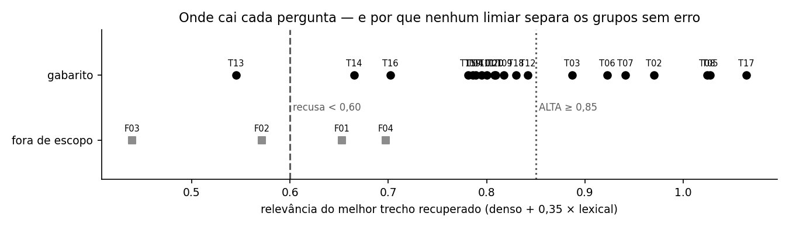

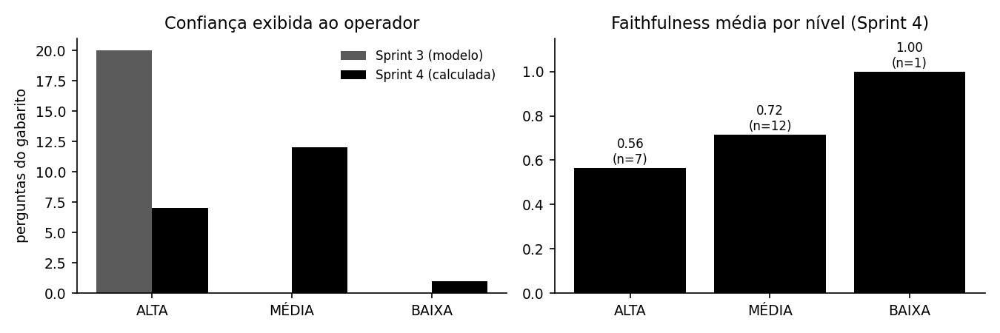

### 3.3 Casos de alucinação e recuperação incorreta

| Caso | O que aconteceu | Contramedida | Estado |
|------|-----------------|--------------|--------|
| **F02** (S3) | Instruções para configurar o inversor de um concorrente, citando a WEG | limiar de recusa | **resolvido**: recusa sem chamar o LLM |
| **T16** (S3) | resposta copiada do exemplo do prompt | exemplo de outro aparelho, sem conteúdo técnico | **resolvido**: a resposta final trata de desbalanceamento e alinhamento com base no trecho |
| **T18** (iteração 1) | "substituir o elemento filtrante a cada 2 000 horas" vazou do exemplo | detectado pelo verificador; exemplo trocado de novo | **resolvido** na versão final |
| **T01** | 155 °C (classe F) vira 150 °C, em todas as versões | verificador lista "150" como sem fonte | **detectado, não corrigido**: o número ainda chega ao operador |
| **T05** | cálculo de potência útil com aritmética errada ("2% de 40 °C = 8 °C") e uma potência nominal inventada ("2.000 cv × 0,90 = 1.800 cv"; a pergunta não informa a potência) | verificador lista "32" e "1800" | **detectado, não corrigido** |
| **T02, T07, T12** | respostas que parafraseiam além do trecho recuperado (faithfulness ≤ 0,25) | — | **aberto** |
| **T13** | pergunta legítima (relevância 0,545) recusada | — | **efeito colateral aceito** do limiar |
| **2º turno dos cenários** | perguntas de seguimento recusadas pelo limiar | consulta composta com o turno anterior | **resolvido** (seção 1.4) |
| **MT-008, 2º turno** | volta a sugerir desalinhamento depois de o operador descartá-lo | — | **aberto**: o modelo de 3B não segura a restrição do diálogo |

**Contramedida planejada para os números.** Quando o verificador encontrar número sem fonte, o sistema deve:
- rebaixar a confiança exibida para BAIXA;
- anexar um aviso explícito ("valor 150 não consta nas fontes — conferir no manual").

A detecção já existe, então o passo é pequeno. Não foi ligado nesta sprint porque mudaria as respostas avaliadas sem nova rodada de avaliação.

---

## 4. Proposta de evolução futura — "Ir além"

### 4.1 Integrar o módulo PLN ao painel do gêmeo digital

- **O que:** o painel Streamlit e a API FastAPI do front da Sprint 4 passam a consumir o módulo `pln/`, em vez de manter uma geração de resumo paralela. São três integrações:
  - resumo de alerta por template, com rastreabilidade;
  - estado operacional por ativo;
  - assistente como uma aba "Perguntar ao manual" dentro do dashboard do ativo, com o estado do ativo já injetado.
- **Tecnologia:** o pacote `pln/` exposto como serviço na API FastAPI existente (endpoint `/assistente`, que já tem API Key e `trace_id`); o Streamlit chama a API.
- **Limitação resolvida:** hoje existem duas camadas de texto que não se conversam, e os resumos do painel (Gemini) não têm a rastreabilidade nem o checklist dos resumos da Sprint 3.
- **Impacto na Forzy:** o operador vê o alerta, lê a explicação rastreável e pergunta ao manual sem trocar de tela. O tempo entre o alerta e a primeira ação diminui.

### 4.2 Avaliação contínua com RAGAS e gabarito independente

- **O que:**
  - escrever um segundo gabarito de 40 a 60 perguntas, com especialista de manutenção e sem ver o índice;
  - recalibrar nele o limiar de recusa e as faixas de confiança;
  - rodar a avaliação a cada mudança de prompt ou de modelo.
- **Tecnologia:** framework RAGAS (faithfulness, answer relevancy, context precision e recall com juiz LLM), mantendo o juiz NLI atual como métrica offline de controle e rodando em CI.
- **Limitação resolvida:**
  - limiar ajustado no próprio conjunto de teste;
  - sensibilidade a prompt de ±0,06 invisível com 20 perguntas;
  - juiz NLI que penaliza paráfrase.
- **Impacto na Forzy:** mudança de prompt ou de modelo só vai para produção com número comparável; regressões como a do 2º turno (seção 1.4) seriam pegas antes da demonstração.

### 4.3 Base documental de manutenção e verificador de números ativo

- **O que:**
  - indexar fichas de manutenção por carcaça, datasheets e procedimentos de relubrificação, inclusive em inglês, usando o glossário PT/EN da Sprint 1 para a ponte de idioma;
  - transformar o verificador de números de *detector* em *bloqueio*: resposta com número sem fonte sai com confiança BAIXA e aviso explícito.
- **Tecnologia:** o mesmo pipeline de chunking por seção; expansão de consulta com os sinônimos do glossário; a regra em `numeros_sem_suporte()` passa a governar a confiança.
- **Limitação resolvida:**
  - as falhas de recuperação T16/T19 e a recusa de T13 vêm de documentação ausente;
  - T01 e T05 mostram que números errados ainda chegam ao operador.
- **Impacto na Forzy:** perguntas de manutenção, as mais frequentes em operação, passam a ter fonte; valores errados param de chegar ao operador com aparência de certeza.

---

## 5. Reprodutibilidade

Pasta `challenge-sprint-4/processamento-linguagem-natural/`:

| Passo | Comando | Tempo (CPU) |
|-------|---------|-------------|
| Avaliar o assistente (gabarito, fora de escopo, cenários) | `python scripts/avaliar_assistente.py` | ~12 min |
| Rodar só os cenários de diálogo | `python scripts/avaliar_assistente.py --so-cenarios` | ~3 min |
| Comparativo Sprint 3 × Sprint 4 | `python scripts/comparar_sprint3.py` | ~7 min |
| Figuras e transcrições de evidência | `python scripts/gerar_evidencias.py` | segundos |
| Prints do Anexo (a partir dos notebooks executados) | `python scripts/gerar_prints.py` | ~30 s |
| Notebook da Sprint 4 | `python scripts/build_notebook_sprint4.py` e depois executar `sprint4_pln_rag.ipynb` | ~1 min |
| Este documento (.docx e .pdf) | `python scripts/gerar_documento_final.py` | segundos |

- **Modelo local:** a variável `MODELO_LLM` aceita o caminho de um `.gguf` já baixado. Sem ela, o modelo é baixado do Hugging Face.
- **Artefatos versionados:** todas as saídas usadas neste documento estão em `relatorios/`. As iterações descartadas ficam em `relatorios/sprint4_iteracao1/` e `relatorios/sprint4_iteracao2/`, e as respostas da Sprint 3 em `relatorios/sprint3_baseline/`.

<!-- nova-pagina -->

## Anexo — Solução em funcionamento: sequência de prints

Esta sequência substitui o vídeo demonstrativo, conforme a alternativa prevista no enunciado. Cada print é uma célula real de um notebook executado, com o código, a saída e o número de execução visíveis. Nada foi recalculado nem editado para as imagens: elas são geradas a partir dos `.ipynb` salvos por `scripts/gerar_prints.py`, e os arquivos ficam em `evidencias/prints/`.

A ordem acompanha o fluxo da solução:
- **P01 e P02 (Sprint 1):** base linguística;
- **P03 e P04 (Sprint 2):** consulta semântica;
- **P05 e P06 (Sprint 3):** geração e classificação de texto;
- **P07 a P13 (Sprint 4):** assistente RAG, incluindo os três cenários de falha.

### Sprint 1 — Base linguística

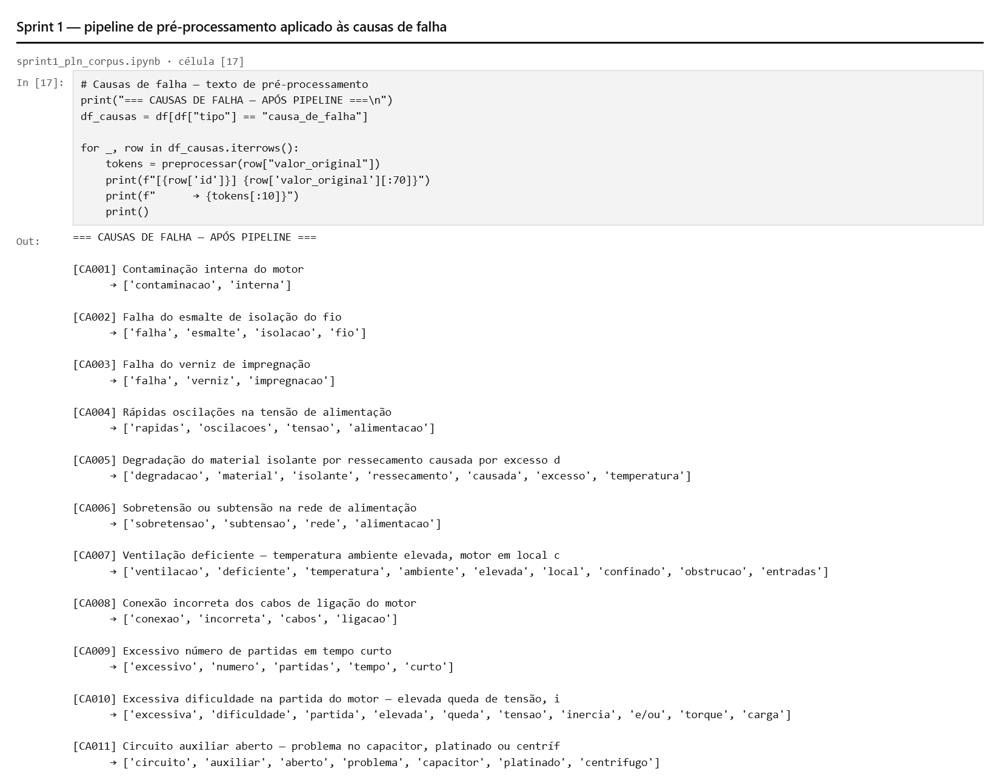

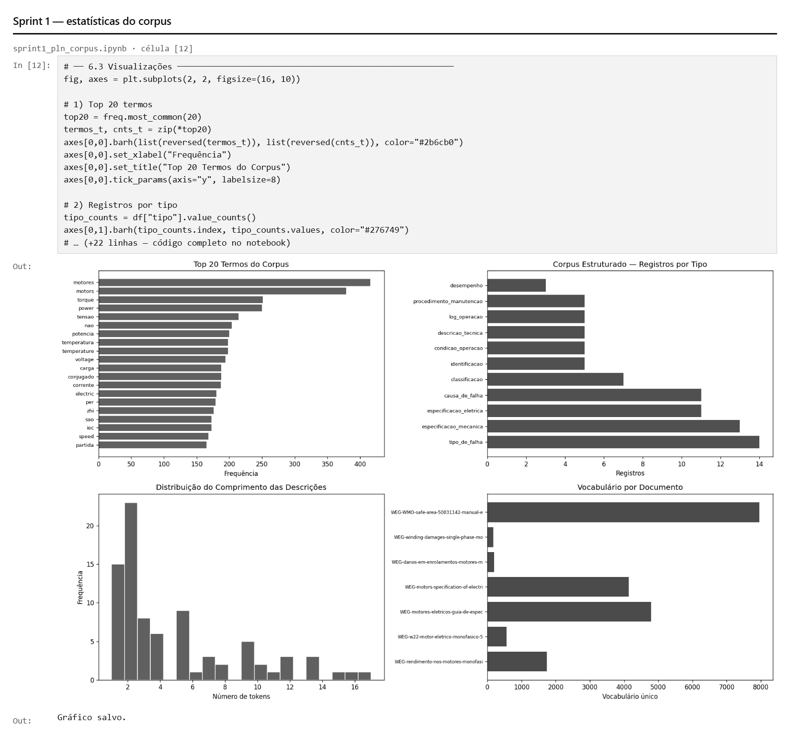

### Sprint 2 — Consulta semântica

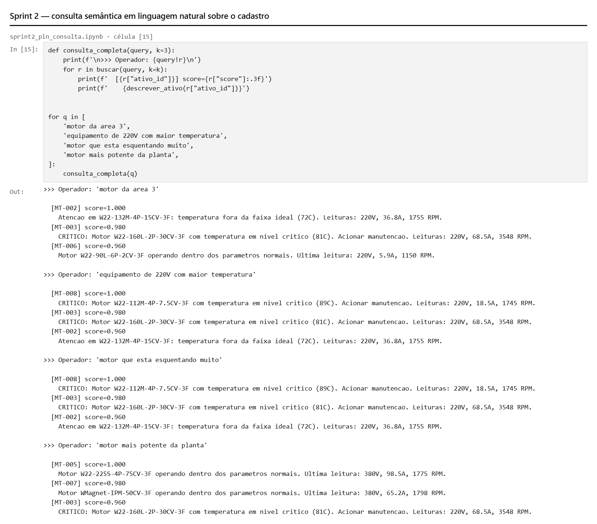

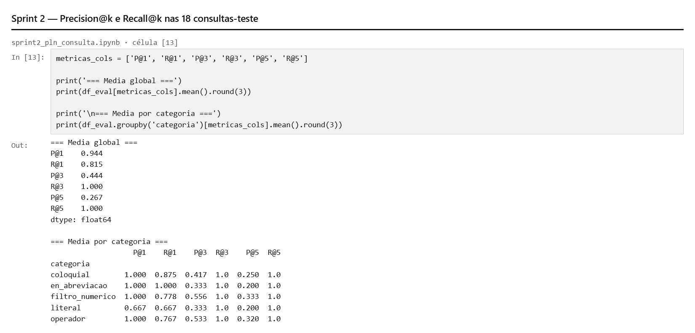

### Sprint 3 — Geração e classificação

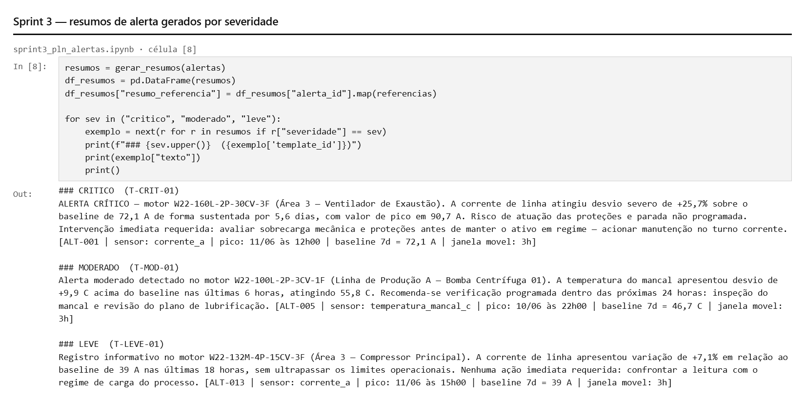

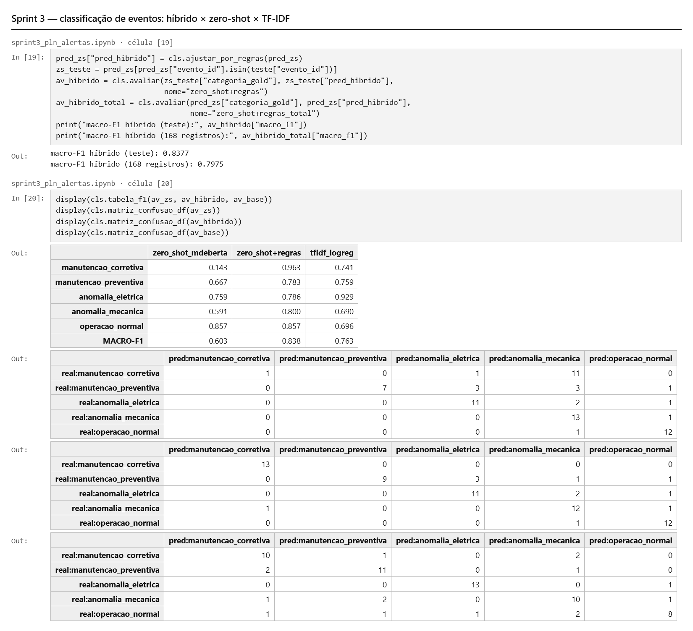

### Sprint 4 — Assistente RAG

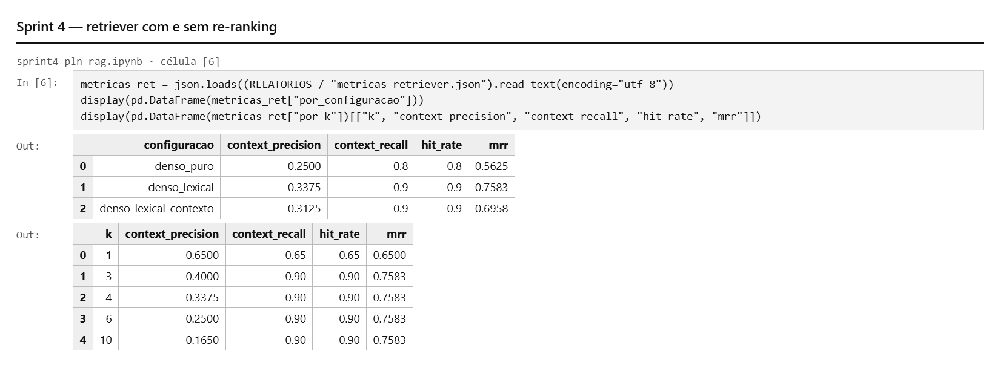

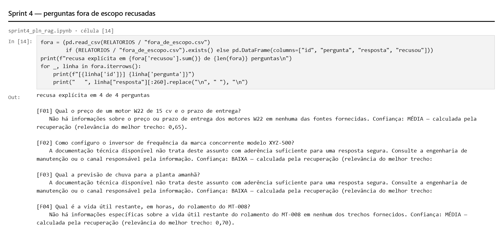

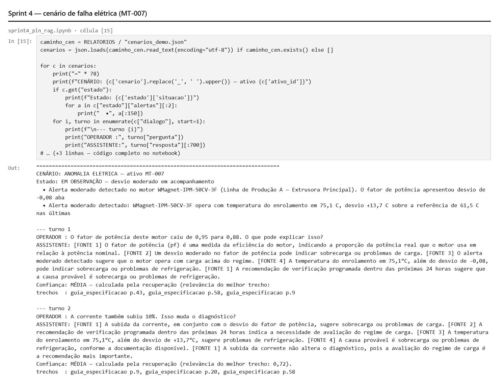

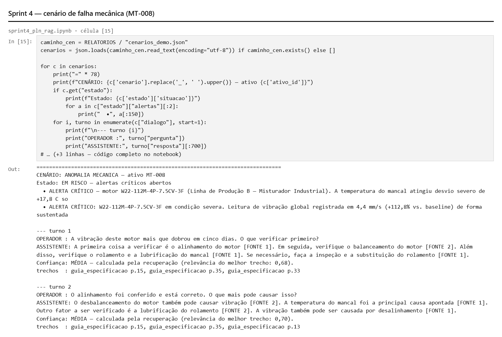

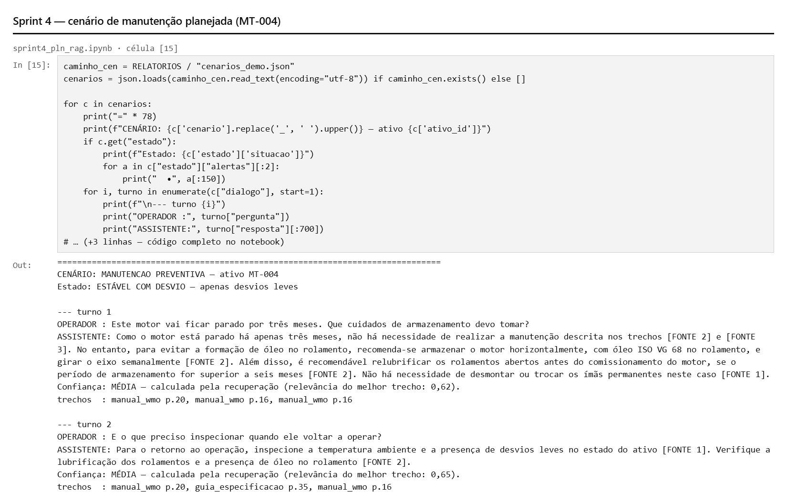

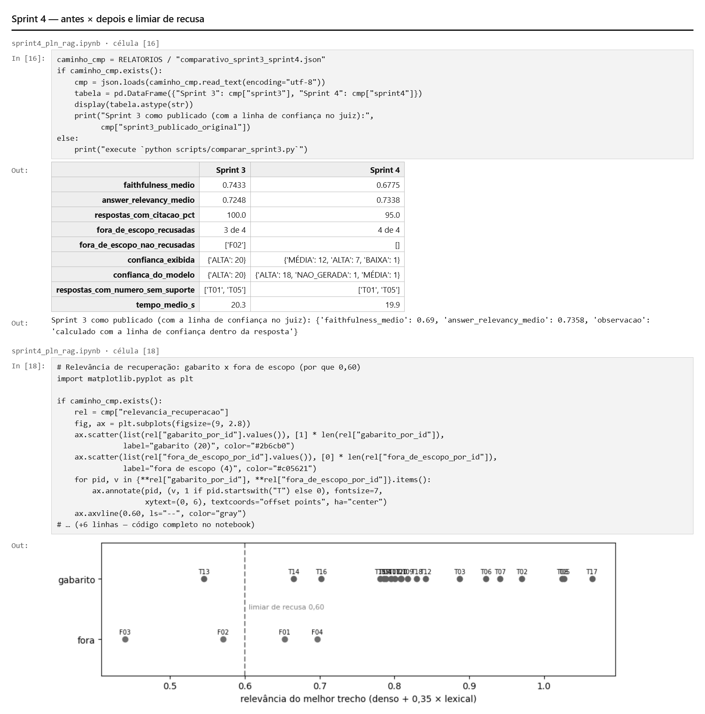

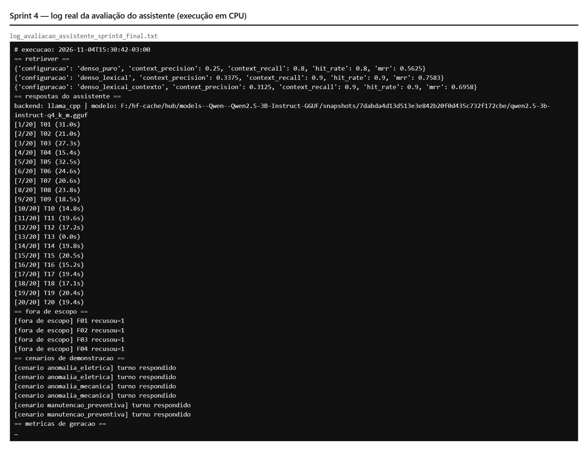
